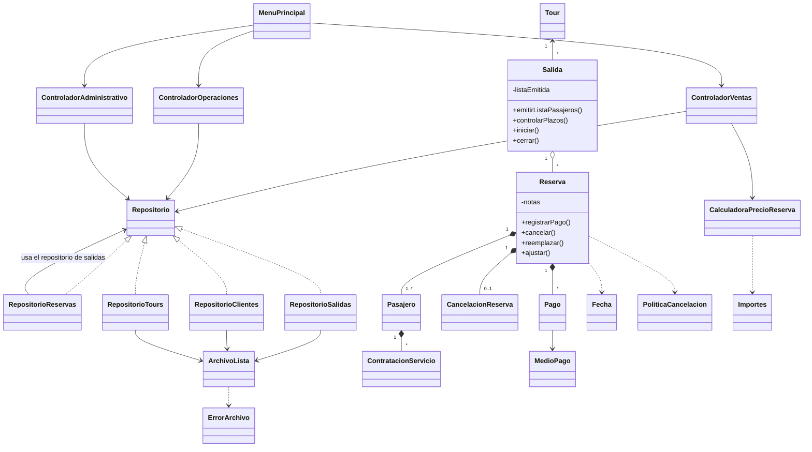

# Revisión de la Etapa 2 · Rumbo Sur

## Dificultades encontradas y cómo se resolvieron

El proyecto original compilaba y su prueba terminaba con éxito, incluso al ejecutarla con las aserciones habilitadas. Sin embargo, el segundo caso pasaba una reserva nula a las promociones, obtenía dos descuentos de cero y nunca comparaba el resultado con un valor esperado. Tampoco se podía completar una venta desde un catálogo vacío porque el menú no ofrecía cargar tarifas.

El problema de datos más importante se veía al cerrar el programa. Ventas y operaciones abrían repositorios de salidas independientes. Una misma reserva podía quedar guardada dentro de una salida y también en otro archivo, con pagos o estados distintos. Además, construir una reserva ya la agregaba a la salida aunque después fallara el alta. Ahora se verifican cupo, pasajeros y precio antes de incorporarla. Una salida y sus reservas se escriben juntas. Después de cargar los datos, la numeración continúa a partir del mayor número guardado.

## Cobertura de la propuesta B

La numeración RN corresponde a la entrega de la Etapa 1.

| Reglas | Operación disponible y lugar de la decisión |
|---|---|
| RN1–2 | El catálogo reúne las tres categorías, actividades por día y orden, proveedor opcional y tarifas por vigencia. Aventura comprueba la edad en la fecha de salida. |
| RN3–5 | Cada pasajero ocupa un lugar, incluido el bebé. El mínimo confirma y el máximo completa la salida. Una baja recalcula la ocupación. Al llegar al control de siete días, una salida bajo el mínimo se cancela. |
| RN6–7 | Operaciones compara los intervalos por documento del guía o patente. La salida comprueba habilitación y capacidad del vehículo. |
| RN8–10 | Ventas exige cliente y salida registrados y al menos un pasajero. La calculadora toma la tarifa de la temporada vigente al salir. Adulto, menor de 12, menor de 3 y jubilado pagan 100 %, 60 %, 0 % y 90 %. |
| RN11–13 | A más de 60 días se descuenta 15 %. Desde seis pasajeros se descuenta 10 %. Se elige el mayor sobre los pasajes y luego se suman los adicionales individuales. Cada pasajero de aventura requiere seguro. |
| RN14–16 | El 30 % confirma la reserva. Se puede completar el saldo hasta diez días antes inclusive. Después se anula la reserva impaga y se liberan los lugares. El 7 % de tarjeta en varias cuotas se cobra aparte del capital. |
| RN17–20 | Cancelación del cliente por franjas, devolución completa por agencia y registro por medio original. El reemplazo conserva los servicios y el precio hasta tres días antes inclusive. |
| RN21–23 | La lista lleva documento, nombre, contacto y restricciones. Un cambio de pasajeros obliga a emitirla nuevamente. Inicio y cierre controlan estado y recursos. El guía asignado cobra por día más 5 % de los adicionales de reservas vigentes. Las correcciones de precio conservan el pago y dejan motivo, fecha, total anterior y diferencia. |
| Reportes | El menú permite consultar ocupación por salida, ventas por legajo, ingresos netos por código de tour y detalle de cancelaciones con sus devoluciones. |

**Proveedores.** Se pueden registrar al cargar una actividad y consultar a quién se contrató. El contexto menciona liquidaciones a proveedores, pero la propuesta B solo define la fórmula, los datos económicos y el caso mínimo de liquidación del guía. No hay monto a pagar ni criterio de liquidación a proveedores en el modelo entregado. Si la cátedra exige esa operación, queda por definir con ella.

## Decisiones para la demostración

- La fecha de trabajo se ingresa al abrir la consola. Permite reproducir un vencimiento en clase. Los controles se ejecutan al abrir y entre operaciones. Con el programa cerrado se aplican en la siguiente sesión.
- La salida dura la cantidad de días del tour, contando inicio y fin. Se pueden cargar distintas vigencias de tarifa para una temporada. Una reserva ya vendida conserva su precio.
- Al vencer un saldo se aplica la política del cliente en el primer día fuera de plazo (nueve días de anticipación). Las reservas vigentes que se cancelan por decisión de la agencia recuperan todo lo cobrado, incluido el recargo. Las devoluciones se registran en el sistema. No hay conexión con bancos.
- El sistema registra el nombre completo en un campo. Para el guía, el identificador laboral se carga como matrícula/legajo. Las habilitaciones y el honorario quedan registrados en la asignación de cada salida. El importe del seguro lo ingresa el operador. Cada contratación corresponde a una unidad para un pasajero.
- Ventas por vendedor suma el precio de las reservas vigentes. Ingresos por tour suma los cobros efectivos, incluye los recargos y resta devoluciones. Es posible vender por un importe y haber cobrado otro.
- La consola está pensada para un operador a la vez. Por elección del grupo, esta versión empieza con archivos nuevos en `datos/`. Conserva el guardado entre ejecuciones de esta versión. Los archivos antiguos de la raíz quedan intactos.

## Diseño y contenidos de la cursada

| Decisión de Etapa 1 | Dónde verla y cómo explicarla |
|---|---|
| SRP | `Reserva` conserva pasajeros, pagos y estado. `CalculadoraPrecioReserva` calcula el precio. Las políticas calculan las devoluciones. |
| OCP | La calculadora recorre una lista de `EstrategiaPromocion` y elige el descuento mayor. Se puede agregar una estrategia mediante `agregarPromocion`. |
| DIP | `Pago` pide el importe cobrado a `MedioPago`. La tarjeta resuelve el recargo. |
| Experto | `Salida` conoce sus reservas para sumar adicionales. `Guia` conoce su tarifa para liquidar los días trabajados. |
| Creador | `Reserva.registrarPago` crea el pago. `Pasajero.contratarServicio` crea la contratación individual. |
| Controlador | El menú recibe los datos. Ventas coordina la reserva, operaciones la salida y administración el catálogo, los reportes y los honorarios. |
| Fabricación pura | Los repositorios implementan `Repositorio` y se ocupan del almacenamiento. Las entidades no abren archivos. |

La presentación depende de los controladores y crea los repositorios al arrancar. Los controladores usan el dominio y la interfaz de repositorio. Persistencia conoce el dominio para guardar y recuperar objetos. El dominio no importa presentación, controladores ni persistencia.

Se consultaron el UML final y las secuencias de crear reserva y registrar pago. La secuencia de alta comprueba los lugares antes de pedir los datos de cada pasajero. Ventas repite esa validación al guardar. El cálculo de precio se delega a la calculadora, tal como se decidió al revisar el diseño inicial. En el pago, la consola identifica el medio, la reserva crea el pago y comprueba la seña. Se distingue el importe acreditado del importe cobrado con recargo.

**Diferencias concretas con el UML.** Los cuatro repositorios y su interfaz llevan nombres en castellano. El menú principal tiene diez opciones, incluida la salida del programa. Crear una reserva, cobrar y consultar el saldo tienen acceso directo. La fecha se elige al abrir el programa. El menú de consola reúne las pantallas y cada caso de uso se resuelve en uno de los tres controladores. Cancelación y ajuste de una reserva se coordinan en ventas porque allí se localiza y persiste la reserva. El UML final ya ubicaba la cancelación en ventas, aunque el texto de GRASP la atribuía a administración. Las notas de ajuste se guardan como un historial de texto en la reserva. Los vencimientos usan una fecha de trabajo explícita. El repositorio de reservas consulta las reservas de cada salida y delega allí la escritura. Se mantienen las cuatro interfaces o familias de implementación del diagrama para repositorios, promociones, medios de pago y políticas.

### Actualización del diagrama para la Etapa 2

Esta vista complementa el diagrama completo de la página 18 numerada de la entrega anterior. Muestra las relaciones y responsabilidades que cambiaron.

**Qué repasar en los PDF de la materia**

| Clase | Ejemplo usado en el proyecto |
|---|---|
| 4, *Tipos de datos en Java* | `substring`, `charAt`, `equals`, conversión de texto a número y aritmética. `Fecha` calcula días y edades con enteros y contempla los años bisiestos. |
| 5, *Interfaces* y *Tipos de datos enumerados* | Contratos de promociones y medios de pago. Un pago registrado conserva sus datos. |
| 7, *Patrones GRASP* | Experto en la liquidación, Creador en pagos y servicios, y reparto entre controladores y repositorios. |
| 11, *Archivos en Java* | Lectura y escritura de objetos, cierre del archivo, creación de carpeta y movimiento de la copia terminada. |
| 12, *Colecciones en Java* y *Excepciones en Java* | `Comparable` en actividades, `Comparator.comparing` en la lista de pasajeros (p. 27), `ArrayList`, `HashMap`, excepciones propias y `finally` para cerrar el lector de consola. |
| 13, *Arquitectura Modelo-Vista-Controlador* y *Java Swing: creación de interfaces gráficas* | Separación de presentación y control. El ejemplo de la p. 28 del PDF de Swing usa `trim()` en la entrada de texto. |

El proyecto se compila solo con el JDK. Los centavos se redondean con multiplicación, conversión a entero y división. La comparación de fechas, el orden de los pasajeros y los movimientos de archivos se pueden localizar por separado en `Fecha`, `Salida` y `ArchivoLista`.

La revisión de las fuentes Java incluyó las pruebas y la precarga. Se contrastaron las llamadas a la biblioteca estándar con el texto de los PDF del ZIP. Las búsquedas en los repositorios, el cálculo de fechas y las validaciones de cupos son métodos del proyecto. En el menú se usaron condicionales y ciclos como los de las clases 11 y 12. La precarga usa arreglos, constructores y los mismos repositorios que usa la consola.

Las fechas de la consola se ingresan y muestran como DD/MM/AAAA. Los códigos de salida también usan ese orden, por ejemplo RS01_15/01/2027. Los archivos conservan sus fechas en el orden usado para compararlas, de modo que se siguen leyendo los datos existentes. Los importes se muestran con coma y dos decimales, y se ingresan sin separador de miles.

## Plan de pruebas y resultados

La verificación actual y las instrucciones para repetirla están en el [Plan de pruebas funcionales](Plan_Pruebas_Funcionales.md). Se compilaron las fuentes para Java 17 y aprobaron 55 comprobaciones unitarias (33 existentes y 22 nuevas) y 24 casos funcionales de consola. No hubo fallas. Queda pendiente una verificación manual en IntelliJ.

Se agregó ReservaSalidaTest.java para comprobar operaciones rechazadas sin alterar los datos, bebés y sobreventa, reemplazos, recursos, lista vigente, cierre y honorarios. Esta ampliación no modificó el código de negocio. Los recorridos usaron carpetas temporales separadas de los datos del proyecto.

## Archivos revisados y cambios

| Archivo o grupo de archivos | Motivo |
|---|---|
| `ControladorVentas.java` | Comparte las salidas con operaciones y coordina alta, cobro, reemplazo, ajuste, contratación y devolución. |
| `ControladorOperaciones.java` | Vincula el catálogo al abrir, controla cruces de fechas, vencimientos, emisión de listas e inicio/cierre. |
| `ControladorAdministrativo.java` | Completa el catálogo, liquida al guía asignado y reúne los reportes. |
| `Tour.java`, `TourAventura.java`, `TourCultural.java`, `TourNaturaleza.java` | Categorías, validación en la fecha del viaje y control de duplicados de vigencia. Aventura exige edad y seguro. |
| `Pasajero.java`, `ServicioAdicional.java` | Edad, datos de emergencia, contratación individual y validación del precio. |
| `Tarifa.java`, `CalculadoraPrecioReserva.java`, `PromocionAnticipada.java` | Validan fecha, categoría y precio y usan las operaciones comunes de importes y días. |
| `Fecha.java`, `Importes.java` (nuevos) | Reúnen los cálculos repetidos de calendario y dinero. |
| `Reserva.java`, `CancelacionReserva.java` | Alta sin efectos parciales, seña, pago, reemplazo, vencimiento, ajuste y devolución por cada medio. |
| `Pago.java`, `MedioPago.java`, `TarjetaCredito.java`, `Transferencia.java`, `Efectivo.java` | Cada pago conserva el capital y las cuotas. El medio determina cuánto se cobra y cómo se identifica en la devolución. |
| `Salida.java`, `Guia.java`, `Vehiculo.java` | Estados, cupo, lista vigente, categorías, idiomas, transporte y liquidación de guía. |
| `Cliente.java`, `Vendedor.java` | Se completaron residencia y comisión y se sustituyeron los datos fijos de la consola. |
| `RepositorioClientes.java`, `RepositorioTours.java`, `RepositorioSalidas.java`, `RepositorioReservas.java` | Repositorios con identificadores consistentes. Una sola copia de las reservas por salida y numeración que sobrevive al reinicio. |
| `ArchivoLista.java`, `ErrorArchivo.java` (nuevos) | Una sola implementación de lectura/escritura para las listas. Una falla de guardado interrumpe la sesión para evitar que se siga operando con cambios solo en memoria. |
| `DatosIniciales.java` | Cinco clientes y cinco viajes. Una salida tiene una reserva con seña, un adicional, guía y transporte para practicar cobros y operación. |
| `MenuPrincipal.java` | Expone las operaciones, pide datos reales y cierra el lector en `finally`. |
| `CalculadoraPrecioReservaTest.java` | Reemplaza el falso positivo de promociones y verifica precios, cupos, plazos, aventura, tarifas y políticas. |
| `README.md`, `docs/demo.txt`, este informe | Instrucciones de ejecución, una venta reproducible, plan funcional, cambios al UML y preparación de la defensa. |

Las políticas de devolución, promoción de grupo, actividad con orden natural y proveedor ya resolvían su parte. Los cambios se concentraron en conectarlas con las operaciones del usuario.

## Defensa y entrega

1. **¿Por qué un bebé figura en la lista si paga cero?** El precio lo calcula la calculadora. La ocupación cuenta pasajeros.
2. **¿Por qué un cobro de 353,10 reduce la deuda en 330?** El pago conserva el capital. La tarjeta calcula el recargo sobre ese importe. La devolución toma lo efectivamente cobrado.
3. **¿Qué impide que se descuente dos veces una promoción?** La calculadora compara descuentos en dinero y resta uno solo. Se puede demostrar con seis pasajeros y 61 días.
4. **¿Qué pasa si se reemplaza un pasajero después de imprimir la lista?** La salida invalida la lista. Hay que emitirla de nuevo para que guías y coordinador tengan los datos correctos.
5. **¿Por qué se guarda la salida junto con las reservas?** Para que al volver a abrir exista un único estado de pagos, cupos y pasajeros para esa salida.
6. **¿Qué diferencia hay entre los ordenamientos?** El itinerario siempre se ordena por día y orden con `Comparable`. La lista usa un criterio particular por nombre con `Comparator`.

### Distribución de tareas

Según el historial local, Santiago trabajó en el modelo, los paquetes, las excepciones, las categorías y la persistencia de tours. Carlos Thomas participó en los requisitos, las validaciones, las tarifas y la integración. Bryan trabajó en promociones, repositorios, controladores, menú y pruebas. El grupo debe confirmar el reparto de las tareas realizadas en conjunto, que el historial por sí solo no permite reconstruir.

### Reflexión para revisar entre los integrantes

La prueba original de promociones terminaba con éxito aunque desde el menú era imposible vender el primer pasaje. Al usar seis pasajeros y comparar el descuento obtenido con un importe esperado, se pudo comprobar cuál de las dos promociones ganaba. Hacer la venta desde un catálogo vacío permitió detectar otro problema, la falta de una opción para cargar la tarifa. Cada prueba respondió una pregunta distinta y ambas hicieron falta para comprobar la venta.

Algo parecido ocurrió con los cupos. Mientras el programa seguía abierto, una reserva podía parecer correcta. Cerrar la consola, volver a abrirla y consultar la misma salida permitió comprobar si la reserva, su pago y la cantidad de lugares ocupados seguían coincidiendo.

**Pendientes de entrega.** No figuran tags locales `etapa-1` ni `etapa-2`. Quedan para el grupo el etiquetado de la entrega, la revisión por otro integrante, las condiciones del repositorio remoto y la defensa individual. Las pruebas se ejecutaron sobre un JDK 24 con destino Java 17. No se probó una instalación independiente de JDK 17 ni la operación de varias consolas simultáneas sobre los mismos datos.
